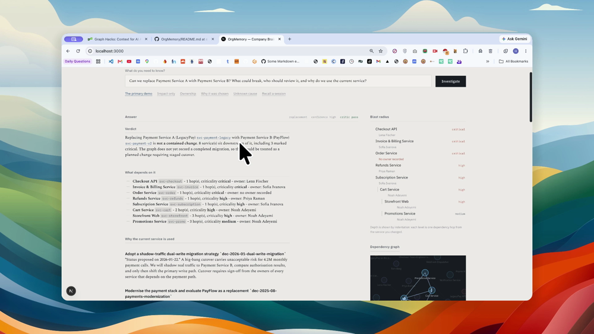
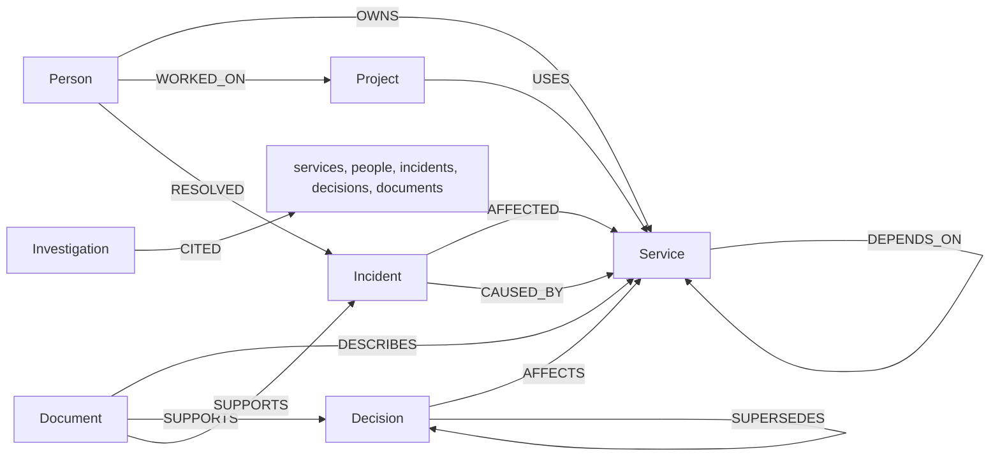

# OrgMemory

**Your company's knowledge, connected and explainable.**

An AI Company Brain built on a [FalkorDB](https://falkordb.com) knowledge graph. It
connects people, services, projects, incidents, decisions and documents, then answers
questions that require multi-hop reasoning — and shows the graph records behind every
material claim.

Built for Graph Hacks.

**Track entered: 03 — Company Brain.** People, teams, projects, documents and decisions
live in one graph; the agent answers questions across all of it and cites the specific
records behind each claim.

## Watch the demo

<video src="demo.mp4" controls></video>

[](demo.mp4)

---

## The problem

Company knowledge is scattered across runbooks, ADRs, postmortems, tickets and the
people who remember. Retrieval-augmented chat over that material returns isolated
snippets: it finds the postmortem but not that the service named in it has three other
services depending on it.

OrgMemory's answer is a graph. When the question is *"can we replace Payment Service A
with Payment Service B?"*, the useful facts are relational — who depends on it, who
owns those, what broke before, what decision led here. Those are joins over a topology,
not sentences to rank.

---

## Quick start

> New here? **[SETUP.md](SETUP.md)** is the step-by-step version, with troubleshooting.

Requires **Python 3.12**, **Node 20.9+**, and a free [FalkorDB Cloud](https://app.falkordb.cloud)
instance. No Docker.

```bash
git clone https://github.com/Harsh-0986/OrgMemory.git
cd OrgMemory

cp .env.example .env      # then fill in the values below
```

### 1. Configure

You need two things in `.env`:

**FalkorDB Cloud** — from *Deployments → Instances → Connectivity*. Copy the endpoint
(`host:port`; the port is often **not** 6379), and the user and password from *Instance
Details*. The Free tier needs no TLS:

```ini
FALKORDB_HOST=instance-xxxxx.your-region.aws.example
FALKORDB_PORT=60756
FALKORDB_USERNAME=falkordb
FALKORDB_PASSWORD=...
FALKORDB_TLS=false
```

**NVIDIA NIM** — from [build.nvidia.com](https://build.nvidia.com). NIM exposes an
OpenAI-compatible endpoint, so the standard LangChain client is simply repointed at it:

```ini
NVIDIA_API_KEY=...
NVIDIA_MODEL=z-ai/glm-5.3-flash
```

> Not every model on NIM's public model list is enabled for every account. If you get
> a 404, probe your own key and pick one that answers.

You can also set `LLM_ENABLED=false` to run the entire application with **no model at
all**. Investigations still run end to end using a deterministic writer built directly
from the graph, so a demo never depends on a metered endpoint.

### 2. Run the backend

```bash
cd backend
uv sync
uv run python -m app.seed.seed --reset   # seeds 52 nodes / 124 relationships
uv run uvicorn app.main:app --port 8000
```

### 3. Run the frontend

```bash
cd frontend
npm install
npm run dev
```

Open <http://localhost:3000> and click **The primary demo**.

### 4. Run the tests

```bash
cd backend
uv run pytest                  # 218 tests
uv run pytest -m integration   # only the tests that need a live FalkorDB
```

---

## The demo

> *"Can we replace Payment Service A with Payment Service B? What could break, who
> should review it, and why do we use the current service?"*

The seeded company is fictional ("Northwind Logistics"). The answer comes back with:

- **8 downstream services across 3 hops**, with the shortest path from each — Checkout,
  Invoice and Order sit directly behind Payment Service A; Storefront is three hops out
  through Cart and Checkout.
- **The owners of each**, derived from `OWNS` edges, not from a guess.
- **Four architecture decisions**, including one marked `superseded` — the graph shows
  the organisation already decided to move off this processor.
- **A gap the agent must not paper over**: Payment Service A depends on
  `svc-identity`; Payment Service B does not. Nothing in the graph explains why.
- **An incident with no recorded cause**, which is reported as unknown rather than
  attributed to anyone.

Then ask a follow-up — *"Who should review the Payment Service A replacement?"* — and the
agent recalls the first investigation from graph memory.

### More questions worth trying

| Question | What it demonstrates |
|---|---|
| What depends on the General Ledger Sync? | Single-hop traversal, no LLM needed |
| Who owns the Checkout API? | Intent routing skips impact analysis entirely |
| Why do we use Payment Service A? | Decision rationale and supersession chains |
| What incidents affected the Webhook Dispatcher and what caused them? | An incident with no `CAUSED_BY` edge — reported as unknown |

---

## Architecture

```
┌──────────────────────────────────────────────────────────────────┐
│  Next.js dashboard                                                │
│  answer · evidence · dependency plate · reasoning trace          │
└───────────────────────────┬──────────────────────────────────────┘
                            │  HTTP (JSON)
┌───────────────────────────▼──────────────────────────────────────┐
│  FastAPI                                                         │
│  GET  /health                                                   │
│  GET  /api/graph/overview                                       │
│  GET  /api/graph/neighborhood?entity_id=…                       │
│  POST /api/investigations                                       │
│  GET  /api/investigations/{id}   ·  GET /api/investigations/history│
└───────────────────────────┬──────────────────────────────────────┘
┌───────────────────────────▼──────────────────────────────────────┐
│  LangGraph workflow      (acyclic — no loops, by construction)  │
│                                                                  │
│   plan ─▶ retrieve ─▶ assemble ─▶ write ─▶ critic ─▶ finalize   │
│                                                    │             │
│                                                  memory ─▶ END   │
└───────┬──────────────────────────────────┬───────────────────────┘
        │                                  │
        │ allowlisted tools only           │ OpenAI-compatible
        ▼                                  ▼
┌───────────────────────┐        ┌────────────────────────────┐
│  GraphToolbox         │        │  NVIDIA NIM                │
│  10 named tools       │        │  (optional; deterministic │
│  hard call budget     │        │   writer when disabled)   │
└───────┬───────────────┘        └────────────────────────────┘
        ▼
┌──────────────────────────────────────────────────────────────────┐
│  GraphRepository — typed, bounded, LLM-free                      │
│  14 parameterised Cypher templates                                │
└───────┬──────────────────────────────────────────────────────────┘
        ▼
┌──────────────────────────────────────────────────────────────────┐
│  FalkorDB  — 7 node labels · 12 relationship types               │
│  people · services · projects · incidents · decisions            │
│  · documents · investigations                                    │
└──────────────────────────────────────────────────────────────────┘
```

### Where the boundary is

The LLM never writes Cypher. It selects from ten registered tools
(`resolve_entity`, `dependency_impact`, `owners_of`, `relevant_engineers`,
`related_incidents`, `decision_history`, `supporting_documents`,
`shared_dependencies`, `upstream_dependencies`, `recall_investigations`) and supplies
arguments. Anything else is refused before it reaches the database.

Every value travels in FalkorDB's `params` dict. The one exception is the traversal
depth, which FalkorDB requires as a literal inside a variable-length pattern; it is
coerced to an `int` and clamped before formatting, and a test asserts a hostile value
cannot survive that substitution.

### What FalkorDB is actually doing here

Not "a place to put the data" — four specific jobs:

1. **Multi-hop impact traversal.** `DEPENDS_ON` is traversed *backwards*, because
   `(A)-[:DEPENDS_ON]->(B)` means A breaks if B breaks. "What breaks if this changes?"
   is a bounded variable-length query, not a join.
2. **Provenance as first-class structure.** Citations are stored as
   `(Investigation)-[:CITED]->` edges, so a later session can *traverse* from a past
   answer back into the services and people it touched. History is part of the graph,
   not a log table.
3. **Supersession chains.** `SUPERSEDES` turns "why do we use this?" into a question
   with an answer that includes its own replacement.
4. **Structured absence.** The absence of a `CAUSED_BY` edge is itself a queryable,
   reportable fact — "we don't know why this happened" is a first-class result.

---

## Graph schema

**Nodes** — `Person` · `Service` · `Project` · `Incident` · `Decision` · `Document` ·
`Investigation`. Every node carries a stable string id (`svc-checkout`) that the whole
system uses as its primary key.

**Relationships**

| From | Relationship | To |
| --- | --- | --- |
| `Person` | `OWNS` | `Service` |
| `Person` | `WORKED_ON` | `Project` |
| `Person` | `RESOLVED` | `Incident` |
| `Project` | `USES` | `Service` |
| `Service` | `DEPENDS_ON` | `Service` |
| `Incident` | `AFFECTED` | `Service` |
| `Incident` | `CAUSED_BY` | `Service` |
| `Decision` | `AFFECTS` | `Service` |
| `Decision` | `SUPERSEDES` | `Decision` |
| `Document` | `DESCRIBES` | `Service` |
| `Document` | `SUPPORTS` | `Decision`, `Incident` |
| `Investigation` | `CITED` | `Service`, `Person`, `Incident`, `Decision`, `Document` |

The same schema as a graph:

<!-- GitHub renders the mermaid fence below as a diagram. A Cypher code fence
     only ever syntax-highlights, which is why the previous version of this
     block never drew as a graph. Keep the info string as mermaid. -->



`CAUSED_BY` is asserted **only** where the source material supports it. The seed
dataset deliberately includes one incident with no cause, so the agent can demonstrate
saying so.

---

## The Cypher the product depends on

All 28 templates live in [`backend/app/graph/queries.py`](backend/app/graph/queries.py)
and are the only strings the agent's tools can execute — the agent never writes Cypher,
it picks from this set. These are the load-bearing ones.

**Impact traversal** — "what breaks if we change this?". `DEPENDS_ON` is followed
*backwards*, since `(A)-[:DEPENDS_ON]->(B)` means A breaks if B breaks. `min(length(p))`
collapses the many paths to one node down to its shortest hop count.

```cypher
MATCH p = (impacted:Service)-[:DEPENDS_ON*1..3]->(target:Service {id: $service_id})
WITH impacted, min(length(p)) AS depth
RETURN impacted.id AS id, impacted.name AS name,
       impacted.criticality AS criticality, depth
ORDER BY depth ASC, impacted.criticality ASC, id ASC
LIMIT $limit
```

**Shared dependencies** — the real migration risk: infrastructure both the old and new
service depend on, which must support both paths at once.

```cypher
MATCH (a:Service)-[:DEPENDS_ON]->(shared:Service)<-[:DEPENDS_ON]-(b:Service)
RETURN shared.id AS id, shared.name AS name, count(*) AS shared_by
```

**Who knows this system** — two-hop traversal across projects and incidents, unioned
into one ranked reviewer list.

```cypher
MATCH (person:Person)-[:WORKED_ON]->(project:Project)-[:USES]->(service:Service {id: $service_id})
RETURN person.id AS person_id, person.name AS person_name,
       person.role AS person_role, project.name AS project_name
UNION
MATCH (person:Person)-[:RESOLVED]->(incident:Incident)-[:AFFECTED]->(service:Service {id: $service_id})
RETURN person.id AS person_id, person.name AS person_name,
       person.role AS person_role, incident.title AS project_name
LIMIT $limit
```

**Supersession chains** — "why do we use this?" becomes a question whose answer includes
its own replacement.

```cypher
MATCH (decision:Decision)-[:AFFECTS]->(service:Service {id: $service_id})
OPTIONAL MATCH (superseding:Decision)-[:SUPERSEDES]->(decision)
RETURN decision.id, decision.title, decision.rationale,
       decision.status, superseding.title AS superseded_by
```

**Structured absence** — the missing `CAUSED_BY` edge is itself a returned fact. The
`OPTIONAL MATCH` leaves `cause` null and `root_cause_known` false, which the writer
turns into an explicit "we don't know why this happened" rather than a guess.

```cypher
MATCH (incident:Incident)-[:AFFECTED]->(service:Service {id: $service_id})
OPTIONAL MATCH (incident)-[:CAUSED_BY]->(cause:Service)
OPTIONAL MATCH (resolver:Person)-[:RESOLVED]->(incident)
RETURN incident.id, incident.title, incident.severity,
       incident.root_cause_known, cause.name AS cause
```

**Provenance as structure** — an answer's citations are written back as
`(Investigation)-[:CITED]->` edges, so a later session can traverse from a past answer
into the services and people it touched. History is part of the graph, not a log table.

```cypher
MATCH (inv:Investigation {id: $investigation_id})
UNWIND $citations AS citation
MATCH (target {id: citation.id})
MERGE (inv)-[:CITED {quote: citation.quote}]->(target)
```

**Cross-session recall** — how a follow-up question reaches a past investigation.

```cypher
MATCH (inv:Investigation)-[:CITED]->(cited {id: $entity_id})
RETURN inv.id, inv.question, inv.answer, inv.created_at
ORDER BY inv.created_at DESC
LIMIT $limit
```

> **Note on the traversal bound.** `[:DEPENDS_ON*1..$max_depth]` is rejected by FalkorDB
> with *"Encountered unhandled type in inlined properties"* — a variable is not allowed
> inside a variable-length range. `build()` therefore interpolates a Python `int` it
> clamps first, so no caller-supplied string can reach the query text.

---

## Grounding rules

These are enforced in code, tested, and visible in the UI:

- **No invented citations.** The critic audits every `[id]` in the answer against the
  ids the run actually retrieved. Citations the graph did not return are flagged in red.
- **No invented causes.** An incident with no `CAUSED_BY` edge is reported as unknown.
- **Confirmed vs. inferred.** Evidence records carry a `confidence` field. Inferences
  are labelled "Potential risk" in the answer.
- **Advisory only.** Recommendations are for humans. Nothing is executed.
- **Bounded.** Three independent limits: an acyclic pipeline, a per-investigation tool
  budget, and LangGraph's recursion limit. Even a misbehaving node terminates.

### Failing honestly

Every LLM node has a deterministic fallback. If the model is slow, rate-limited or
disabled, the API still returns an answer composed directly from graph evidence, with
citations and the reasoning trace. It says which writer produced it.

---

## Project layout

```
backend/
  app/
    graph/       connection · schema · queries (the 28 Cypher templates) · repository
    agent/       state · tools (the allowlist) · nodes · prompts · graph (LangGraph)
    api/         routes · error envelope · dependencies
    seed/        the synthetic company + repeatable seeder
    models/      domain types carrying provenance
  tests/         218 tests, no model calls, optional live-DB integration tests
frontend/
  app/           dashboard
  components/    answer · evidence · graph · impact · trace · history
  lib/           typed API client · force layout · types
```

### Testing approach

Tests never call the model. An in-memory repository built from the same seed data
reproduces the Cypher semantics — including the reverse traversal — so the whole agent
pipeline runs deterministically and free. Tests marked `integration` run the same
assertions against a live FalkorDB instance to prove the Cypher agrees.

This mattered: the in-memory model and the live driver disagreed several times
(`.result_set` returns *positional* rows, not dicts; FalkorDB rejects a parameter
inside a variable-length relationship range). Those bugs would all have shipped
otherwise.

---

## Technology

| | |
|---|---|
| Backend | Python 3.12 · FastAPI · Pydantic v2 · LangGraph |
| Graph | FalkorDB (Cloud or self-hosted) |
| LLM | NVIDIA NIM via `langchain-openai` (optional) |
| Frontend | Next.js 16 · React 19 · Tailwind CSS 4 · TypeScript |
| Graph rendering | Hand-rolled force layout in SVG — no plotting dependency |
| Tooling | `uv` · pytest · ruff |

---

## Deployment notes

The backend is a standard ASGI app and the frontend a static Next.js build, so both
deploy as-is on any container platform. Two things to set in production:

- `CORS_ORIGINS` must list the frontend's **exact** origin. `localhost` and `127.0.0.1`
  are different origins to a browser.
- `FALKORDB_TLS=true` for any tier above Free.

---

## Acknowledgements

All data in this repository is **synthetic**. The company, its people, services,
incidents and decisions are invented for demonstration, and source URIs point at a
reserved example domain.
